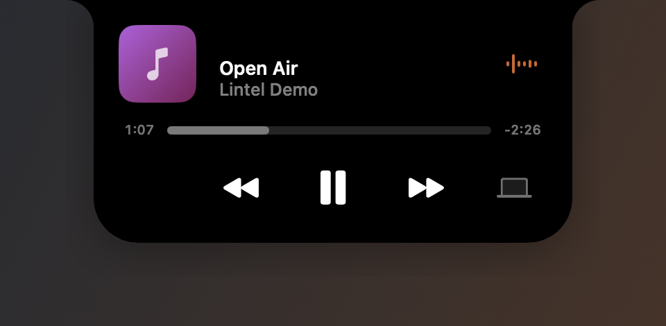
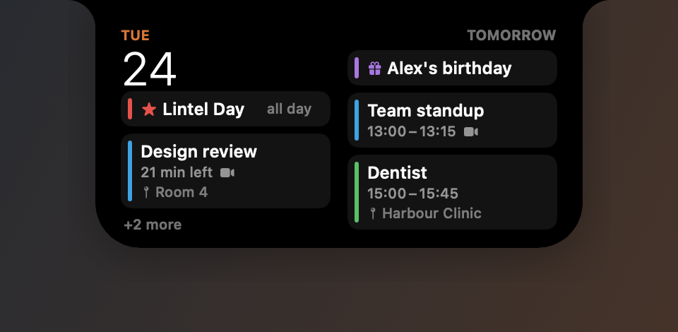
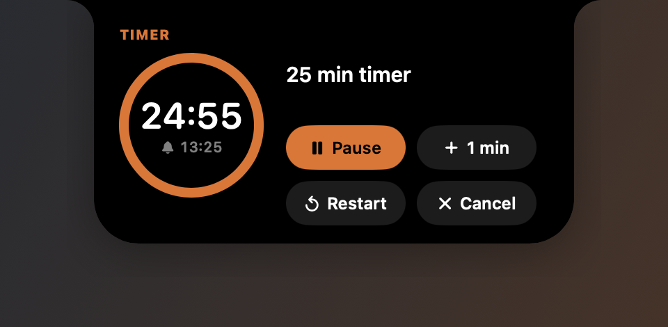

# Lintel

Lintel turns the notch of your Mac into a small, interactive island. What's playing, your next
event, a timer, the volume and brightness, alerts and a shelf for files all sit where the notch is,
and the island opens into a card when you point at it. On a display without a notch, Lintel shows a
pill at the top of the screen instead.

## Download

**[Download Lintel](https://github.com/monroedb/lintel/releases/latest/download/Lintel.dmg)** for
macOS 15 or later (Apple Silicon and Intel). Every version, a .zip and the SHA-256 checksums are on
the [Releases page](https://github.com/monroedb/lintel/releases/latest).

Open the disk image and drag Lintel into Applications. Lintel isn't notarized by Apple, so macOS
blocks it the first time you open it:

1. Open Lintel. When macOS says it can't verify it, click **Done**.
2. Open **System Settings › Privacy & Security**, scroll down to **Security** and click **Open
   Anyway** next to the message about Lintel.
3. Confirm with **Open Anyway** and your password or Touch ID. Lintel opens, and from then on it
   opens normally.

Each new version needs Open Anyway once more. Releases are all signed with the same certificate,
so your settings and permissions carry over when you update.

<p align="center">
  
  
</p>
<p align="center">
  
  
</p>

## Features

- **Now Playing.** Artwork and a live waveform beside the notch while music or a video plays, from
  any app: Music, Spotify, a browser tab and others. Open the island for the player: progress and
  seeking, controls, the output device, audio-format badges and Copy Link. Quick Peek shows the
  new track for a moment when it changes, and a swipe on the island skips.
- **Volume and brightness.** Lintel's own indicator replaces the system's for the volume, mute and
  brightness keys. It has a few looks, fine steps with ⌥⇧, and works with BetterDisplay for
  external displays.
- **Calendar.** A countdown to your next event beside the notch, and today's and tomorrow's events
  (or the month) in the open card. Meeting links open with one click (FaceTime, Zoom, Google Meet,
  Teams, Webex). Time to leave uses travel times from Apple Maps. There's an optional hourly chime,
  and the weather on a free day.
- **Timer.** Presets, a ruler you scrub to set the time, or a typed duration. A compact countdown
  sits beside the notch and an alert rings at the end. `lintel://timer?minutes=25` links work from
  Shortcuts and launchers.
- **Shelf.** Drop files, folders, images, text or links on the notch to keep them at hand. Drag
  them out again, open them, Quick Look, share or copy them.
- **Alerts.** Battery (low, charging), audio devices connecting (with AirPods battery levels) and
  Focus turning on or off, with sounds and haptics.
- **Stays out of the way.** The island hides in full-screen apps, and in games if you like. It
  tucks into the notch with Mission Control and stays still while you switch Spaces. When nothing
  happens it uses about 0 % CPU.
- A Settings window, an optional menu-bar item, and Open at login.

## Requirements

- macOS 15 Sequoia or later, on Apple Silicon or Intel.
- A Mac with a notch, or any display: without a notch the island is a pill at the top centre.
- To build: Xcode (or the Command Line Tools) with Swift 6, and CMake for the bundled media
  adapter (`brew install cmake`).

## Build from source

```sh
git clone --recursive https://github.com/monroedb/lintel.git
cd lintel
swift run lintel-checks        # logic checks
./scripts/build-app.sh         # builds and signs build/Lintel.app
open build/Lintel.app
```

The media adapter is a git submodule (`ThirdParty/mediaremote-adapter`). If you cloned without
`--recursive`, `build-app.sh` fetches it.

## Install

```sh
./scripts/install-app.sh       # builds a release copy and installs it as /Applications/Lintel.app
```

Quit Lintel first if it's running. Turn on **Open at login** in Settings › General.

### Signing

`build-app.sh` signs with the first **Apple Development** certificate in your keychain, or ad-hoc
if there is none. A free Apple ID can create one in Xcode › Settings › Accounts › Manage
Certificates. Set `SIGN_IDENTITY` to choose another identity, or `SIGN_IDENTITY=-` for ad-hoc.

macOS ties the permissions you grant to the app's signature. With a certificate they carry over
from one build to the next. An ad-hoc build counts as a new app every time, so you grant them
again. If a permission looks on in System Settings but Lintel behaves as if it weren't, remove
Lintel from that list (−) and add `/Applications/Lintel.app` again (+).

Releases on the Releases page are signed with Lintel's own self-signed certificate, "Lintel
Release", which stays the same from one version to the next. A copy you build yourself has another
signature, so switching between a download and your own build means granting the permissions again.
A copy you built yourself opens without the Open Anyway step; on macOS 15 and later, Control-clicking
a downloaded copy and choosing Open no longer skips it.

## Permissions

Lintel asks for a permission when you turn on the feature that needs it. The island itself needs
none.

| Permission | What it's for |
|---|---|
| Accessibility | Taking over the volume, mute and brightness keys for Lintel's indicator. |
| Full Disk Access | Knowing which Focus is on: macOS keeps it in a file that only apps with Full Disk Access can read. |
| Calendars | The countdown to your next event and the agenda. Read only. |
| Location | Local weather and travel times for time to leave (see Privacy). |
| Bluetooth | Battery levels of your headphones and speakers. |
| System audio recording | The live waveform: Lintel analyses the playing app's sound. Nothing is recorded or stored. |
| Automation | Controlling Music and Spotify, and finding the browser tab that plays the media. |

Open at login adds Lintel to System Settings › General › Login Items.

## Privacy

Lintel has no analytics, no telemetry, no account and no update checks. This is everything that
leaves your Mac, and when:

- **Weather (Open-Meteo).** With the weather on and Location allowed, Lintel asks
  `api.open-meteo.com` for the forecast. It sends your location rounded to 0.01° (about 1 km), with
  no key or account. Weather data by Open-Meteo.com, CC BY 4.0.
- **Time to leave (Apple Maps).** With Location allowed, Lintel asks Apple Maps (MapKit) for
  travel times to an event's place. Apple receives the place and your location.
- **Copy Link (Apple Music).** When you choose Copy Link for an Apple Music track, Lintel looks up
  its share link with Apple's iTunes Search API, using the title and artist.
- **Spotify artwork (fallback only).** With the media adapter switched off, Lintel downloads the
  playing track's artwork from Spotify's image server.

Meeting links and links on the Shelf open in your browser or app only when you click them. Your
calendars, media, Focus, Shelf items and settings stay on your Mac.

## Known limits

- Now Playing across apps uses a private macOS framework through
  [mediaremote-adapter](https://github.com/ungive/mediaremote-adapter), and a macOS update can
  break it. Without it, Lintel falls back to AppleScript for Music and Spotify.
- A few other features use private or undocumented interfaces: keeping the island still during
  Space switches, built-in display brightness and headphone battery levels. Each can be switched
  off in Settings and has a public fallback.
- Mission Control is detected from its windows. If a script opens it with no key, click or gesture,
  the island tucks in within about a second instead of at once.
- Knowing which Focus is on needs Full Disk Access.
- External displays change brightness only through BetterDisplay.
- The blur behind the open card is an approximation: macOS has no public variable blur.
- Opening and closing the card can drop a frame now and then.
- Lintel isn't notarized, so a downloaded copy needs **Open Anyway** once per version (see
  [Download](#download)).

## License

MIT, see [LICENSE](LICENSE). Third-party software and data are listed in
[THIRD_PARTY_NOTICES.md](THIRD_PARTY_NOTICES.md): mediaremote-adapter (BSD 3-Clause) and the
weather data by Open-Meteo (CC BY 4.0). Contributions are welcome: see
[CONTRIBUTING.md](CONTRIBUTING.md).
